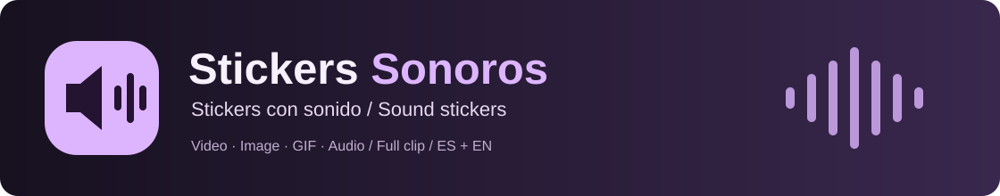
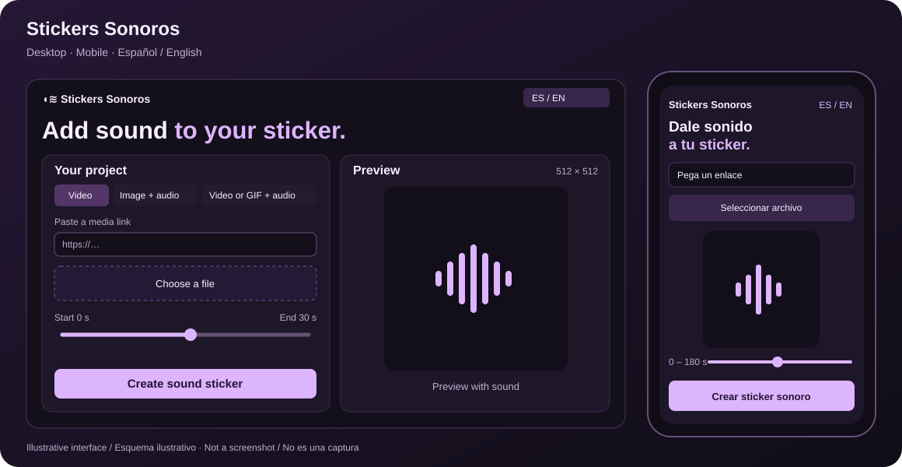
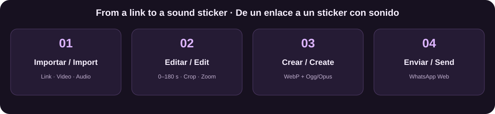

# Stickers Sonoros



**Create sound stickers for WhatsApp in four simple steps.**  
Video, image or GIF + audio · 9+ FPS for animation · up to 2 MB combined · no fixed duration cap.

[**Open the official app**](https://poldkent.github.io/stickers-sonoros/) · [Español](README.md) · [Mobile guide](docs/MOBILE.md#english) · [Support](SUPPORT.md#english)

[](https://github.com/PoldKent/stickers-sonoros/actions/workflows/smoke.yml) [](https://github.com/PoldKent/stickers-sonoros/actions/workflows/render-diagnostic.yml)

**Latest version with operator-confirmed mobile sending: 2026.11.26.44.** [Editor checks](https://github.com/PoldKent/stickers-sonoros/actions/runs/45936518113), [Pages deployment](https://github.com/PoldKent/stickers-sonoros/actions/runs/45936517767) and [importer diagnostic](https://github.com/PoldKent/stickers-sonoros/actions/runs/45936642813) passed for bcf7d48. Version .45 extends the private bridge; check its CI and real-device tests before calling it validated. Render importer is API-only and redirects its root with HTTP 308 to the official site. The separate bridge does not serve another web interface.

## Quick start



| Screen | What to do |
|---|---|
| **1. Import** | Choose Video, Image + audio or Video/GIF + audio. Paste a public HTTPS link or select a local file; add a separate audio track if required. Select **Next** once content and audio are ready. |
| **2. Edit** | Preview the media, trim its start/end, explore the timeline, adjust framing, zoom, position and rotation. Use **Use full source** to reset trimming. Select **Next**. |
| **3. Create** | Choose quality and size budget, optionally add a creator signature, then select **Create sound sticker**. Review the generated WebP and audio, actual resolution, FPS and total size. Select **Next** after conversion succeeds. |
| **4. Send** | Save the original-name `.sonoro.json` package and follow the WhatsApp Web instructions below. |

**Back** and **Next** retain the project and settings. The numbered step buttons can also navigate to accessible steps. Sending is locked until a valid package exists. Changing source, edit settings, signature or quality invalidates the previous result; generate it again. Try **Try an example** on the Import screen if you do not have a file.



## Editing and quality

- The full source is selected initially; there is no fixed time limit. The preview timeline shows the current position and total duration, with start/end markers and playback from the cursor within the selection.
- The 512 × 512 editing canvas supports exact position (0.1 px), zoom (0.01%), rotation in 90° steps, fit/fill and magnetic alignment. **Center** resets position only; guides are not exported. **Use frame + audio** creates a still sticker.
- All modes convert the original media and selected audio track directly using the crop/zoom/rotation settings, without recording an intermediate video. Animated WebP intervals are not merged into long holds. All animation profiles keep at least 9 encoded FPS; static sources and repeated original frames do not gain artificial motion.
- **Maximum sharpness** favors resolution; **Balanced** and **Maximum smoothness** trade resolution for motion. Output resolution and compression adapt to the budget. If it cannot fit at 9 FPS or above, shorten the selection or use a still frame.

| Limit | Optional: experimental extended | Default: recommended |
|---|---|---|
| Combined WebP + Ogg | 2,000,000 bytes | 1,000,000 combined bytes |
| Animation | ≥9 FPS | ≥9 FPS |
| Duration | No fixed cap | No fixed cap |

The JSON transport envelope is larger because of Base64. The local input guard (80 MiB), memory, available codecs and server request/byte limits still apply. WhatsApp may reject long or large stickers; 2 MB is the experimental editor budget, not a guaranteed WhatsApp limit. New files are capped at 2,000,000 combined bytes; the desktop bookmark retains support for reading older packages up to 4 MB; the mobile bridge accepts up to 2 MB. If sending fails, use Compatible (1 MB total).

### Creator signature

Optionally add a name or nickname (40 characters). EXIF retains the pack name **Creado en Stickers Sonoros**, the official URL and the optional signature. The signature is public to recipients, not painted on the image. Audio linkage uses SHA-256; WhatsApp determines how attribution is displayed.

### Import sources

Local video, images, GIF and audio, direct public HTTPS media, and supported public pages/social links can be imported. The Render API handles supported remote imports; editing is local. If TikTok import fails, the external [SnapTik](https://snaptik.fi/) fallback is manual and only for authorized content; the app does not automatically send your link there.

## Send to WhatsApp

On screen 4, **Send**:

1. Select **Save sound sticker** to download `original-name.sonoro.json`. Do not attach the JSON directly to a chat.
2. Show your browser's bookmarks bar (Ctrl + Shift + B; Mac: ⌘ + Shift + B). Drag **Send sound sticker** to it, or select **Copy bookmark address** and paste it into a new bookmark's URL. Replace outdated bookmarks.
3. Select **Open WhatsApp Web**, sign in and open your own chat for the first test.
4. Click the bookmark within WhatsApp Web, select the downloaded package, click **Send sticker with sound**, confirm the recipient and check sound playback. If offered, temporary sound compatibility may be required.

This is an unofficial integration adapted from Shirtep; sessions remain in the browser. Acceptance depends on WhatsApp and the account. If rejected, try Compatible mode or a shorter selection. No extension is required.

### Android and iPhone

On a phone, create a sticker and use the private bridge on the Send screen. To reuse an existing file, open [Send saved sticker](https://poldkent.github.io/stickers-sonoros/mobile.html). The reader validates the JSON, previews the image and audio and submits them unchanged through the private bridge. A linked secondary account and private access key are required. See the [mobile guide](docs/MOBILE.md#english). The WhatsApp Web bookmark remains available on desktop.

## Verification and compatibility

| Area | Evidence |
|---|---|
| Four-screen wizard and translations | Browser CI passed in .38 |
| Single official website and synchronized API | .38 diagnostic passed: Render root HTTP 308, app.js 404, canonical and noindex correct |
| Public importer in production | HTTP 200, 788,493-byte MP4; both API CORS preflights passed (OPTIONS 204) |
| 38-second animation cadence | .36 CI checks 342 ANMF frames, timing and motion across the clip |
| 240-second image + audio | .35 CI generation, decoded audio and simulated send |
| Actual WhatsApp send | User-confirmed in .12; long/large files still require real tests |
| TikTok | User-confirmed 27.14-second clip in .18; not universal |
| Responsive Spanish/English | Chromium at 320, 390, 740 and 1024 px; not physical device certification |

Use updated Chrome or Edge for WebCodecs, WebP and Opus. Animated GIFs require ImageDecoder. Only import material you have permission to use. [Actual CI screenshots](https://github.com/PoldKent/stickers-sonoros/actions/workflows/smoke.yml) are temporary artifacts; the README illustrations are diagrams, not screenshots.

## Development and deployment

**Static editor:** run `python -m http.server 8000` at the repository root and visit `http://localhost:8000`. Use the full service for social links.

```sh
docker build --target local-editor -t stickers-sonoros .
docker run --rm -p 8080:8080 stickers-sonoros
```

Visit `http://localhost:8080`. The root Dockerfile is the only build file.

- GitHub Pages is the only official website and serves the frontend from `main`. Its canonical URL is also included in sticker EXIF attribution.
- Render exclusively hosts the supporting API configured in `index.html`; its root permanently redirects to the official website (HTTP 308). It does not serve the editor or its assets. Responses carry `X-Robots-Tag: noindex, nofollow`.
- Render uses `render.yaml`, the production Docker image (without frontend files) and the free plan, with deployments after checks pass. If needed, use **Manual sync** in the Blueprint and **Manual Deploy** in the service.
- `/health` reports the service version, capabilities and yt-dlp version. Free instances may sleep.

| Route | Purpose |
|---|---|
| GET/HEAD `/` | Permanent redirect to the official website |
| GET `/health` | Status and capabilities |
| POST `/api/import` | Supported public social video |
| POST `/api/media` | Public HTTPS resource or inert HTML |

## Tests

```sh
node --check app.js
node --check i18n.js
python -m unittest discover -s importer -p 'test_*.py'
python tests/test_http.py
python tests/test_format_selection.py
```

For browser tests, install Playwright and Chromium in the development environment, run the static server on port 8000 and execute `node tests/smoke.mjs`. Browser tests use FFmpeg to create media fixtures; format-selection tests need yt-dlp. See [CI runs](https://github.com/PoldKent/stickers-sonoros/actions/workflows/smoke.yml) and [live service diagnostics](https://github.com/PoldKent/stickers-sonoros/actions/workflows/render-diagnostic.yml). README images are illustrative diagrams; actual Chromium screenshots are attached as CI artifacts when generated.

## Privacy and limits

File processing is local by default. The importer accesses the supplied public URL and removes temporary files after responding. Edited clips are not uploaded to the server. The service limits size, time and concurrency; its HTTPS reader validates domains, public DNS and TLS. CORS is not authentication or a replacement for network egress restrictions and infrastructure isolation. Do not store secrets in the public importer. See [audit and security notes](docs/AUDIT.md).

## ❤️ Support the project

To voluntarily support noncommercial maintenance, see [USDC or BBTC donation instructions on Ethereum (ERC-20)](SUPPORT.md#english). Do not send native BTC, other tokens or use other networks. The app does not sell features, require payment or automate transfers.

## Credits and license

The converter and adapted publishing mechanism come from [Shirtep/WA-audio-stickers, commit 25f7909](https://github.com/Shirtep/WA-audio-stickers/tree/25f790945134f395c4bed4f0deea380ac3a2b778). The original [copyright notice and PolyForm Noncommercial 1.0.0 license](vendor/shirtep/LICENSE.md) are retained. No commercial-use rights or official affiliation with WhatsApp, TikTok or Binance are implied. Confirm with the rights holder any use or funding that could constitute commercial exploitation.

### Private mobile sending (.45)

The operator confirmed first native sticker receipt, audio, favorites and forwarding on .44. Version .45 adds a fixed endpoint, bounded reusable sessions and experimental tiers up to 2 MB; real acceptance is pending. See the [mobile guide](docs/MOBILE.md). The bridge uses an unofficial client with account restriction risk; it is not an official API.

In .47 mobile sending is guided: enter the access key, connect WhatsApp and confirm the send. The trial tier is selected automatically; no URL or technical limit configuration is required. The desktop bookmark is in a collapsible section.

### .48 — Un único presupuesto de creación / One creation budget

En Crear: 1 MB total recomendado por defecto, 2 MB total opcional experimental. En Enviar no se seleccionan tamaños ni niveles. El puente recibe el paquete original, valida hasta 2.000.000 bytes combinados y decodifica el audio completo sin tope fijo de duración; se mantienen límites de recursos y sesión. En computadora se elige WhatsApp App (predeterminado) o WhatsApp Web (marcador); en móvil solo WhatsApp App. El operador reportó compatibilidad hasta 1 MB sin límite fijo de duración observado; 2 MB y duraciones arbitrarias no son garantía de WhatsApp. La clave privada y el destinatario fijo se mantienen.

In Create: 1 MB combined recommended by default, optional experimental 2 MB. Send does not select size or tier. The bridge receives the unchanged package, validates up to 2,000,000 combined bytes and decodes full audio without a fixed duration ceiling; resource/session guards remain. Desktop offers WhatsApp App (default) or WhatsApp Web (bookmark); mobile only WhatsApp App. The operator reported compatibility up to 1 MB without a fixed duration limit observed; 2 MB and arbitrary durations are not guaranteed by WhatsApp. Private key and fixed recipient remain.
