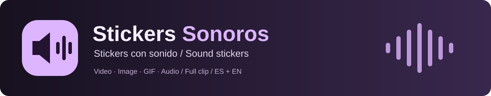

# Stickers Sonoros



**Crea stickers con sonido para WhatsApp desde tu navegador.**  
Video, imagen o GIF + audio · hasta 60 segundos · Español / English.

[**Abrir aplicación**](https://poldkent.github.io/stickers-sonoros/) · [Servidor Render](https://stickers-sonoros.onrender.com/) · [English README](README.en.md) · [❤️ Apoyar el proyecto](SUPPORT.md)

[](https://github.com/PoldKent/stickers-sonoros/actions/workflows/smoke.yml)


[Capturas reales de la última versión verificada](https://github.com/PoldKent/stickers-sonoros/actions/runs/45852351963#artifacts) (artefactos temporales de CI).

## Cómo funciona


1. Pega un enlace multimedia HTTPS o selecciona un archivo de tu dispositivo.
2. Reproduce el tramo, elige el inicio y el final (hasta 60 s) y ajusta el encuadre, posición o zoom.
3. Pulsa **Crear sticker sonoro**. El editor prepara un video y, si el navegador dispone de los códecs necesarios, un paquete con WebP y Ogg/Opus vinculados.
4. Sigue los cuatro pasos de envío que aparecen debajo de la vista previa. El archivo del sticker es `.sonoro.json`, no un vídeo MP4.

## Funciones

- Importación directa de video, imagen y audio; detección de recursos públicos en páginas compatibles.
- Importador propio con yt-dlp y alternativa para direcciones públicas de descarga de TikTok.
- Editor cuadrado de 512 × 512, reproducción previa, selección de fotograma, imagen o GIF con audio.
- Recorte inicial de hasta 30 segundos, máximo de 60 segundos. Calidad ajustada para los límites del conversor: 1 MB para WebP y 1 MB para Ogg.
- Interfaz adaptable a celulares, tablets y computadoras. Selector Español/English persistente.
- Edición y generación locales; no se requiere instalar programas ni extensiones.

## Enviar a WhatsApp

### Computadora (WhatsApp Web)

1. **Guarda tu sticker.** Pulsa **Guardar sticker sonoro** para descargar `sticker.sonoro.json`. No abras el archivo ni lo adjuntes al chat.
2. **Prepara el botón de envío (solo la primera vez).** Muestra la barra de favoritos con Ctrl + Shift + B (Mac: ⌘ + Shift + B) y arrastra el enlace **Enviar sticker sonoro** de la app a esa barra. Si no puedes arrastrarlo, pulsa **Copiar dirección del marcador**, crea un favorito nuevo llamado Enviar sticker sonoro y pega la dirección en su campo URL. Si ya tienes el favorito, salta este paso.
3. **Abre el chat de WhatsApp.** Pulsa **Abrir WhatsApp Web**, inicia sesión y abre el chat deseado. Para tu primera prueba, usa tu propio chat.
4. **Selecciona el archivo y envía.** Dentro de WhatsApp Web, pulsa el favorito, selecciona el archivo del paso 1 y pulsa **Enviar sticker con sonido**. Si se ofrece Activar compatibilidad con sonido, márcala antes de enviar. Confirma el destinatario y comprueba la reproducción.

El marcador usa una integración no oficial basada en Shirtep, dentro de la sesión del navegador. No envía la sesión al servidor ni cambia permanentemente la configuración de la cuenta. Los paquetes anteriores son compatibles. Los marcadores antiguos deben sustituirse para obtener mejoras de idioma o duración. **El archivo JSON no se adjunta directamente a un chat.**

### Android y iPhone

Puedes importar, editar y guardar el archivo `.sonoro.json` desde un navegador compatible. Transfiérelo a tu computadora y sigue los cuatro pasos de WhatsApp Web. El envío nativo desde Android o iPhone no está implementado.

## Estado y compatibilidad

| Función | Verificación |
|---|---|
| Envío de sticker sonoro al propio chat | Prueba real confirmada por el usuario en .12 |
| Importación de TikTok | Prueba real confirmada por el usuario con un clip de 27,14 s en .18 |
| Paquete de 60 s y envío | Generación real y envío simulado en CI; falta validar envío real de 60 s |
| Diseño móvil e idioma | Pruebas Chromium con 320, 390, 740 y 1024 px; no equivalen a pruebas físicas de todos los teléfonos |
| Importación universal de redes sociales | No garantizada; depende del origen |
| Envío a todas las cuentas de WhatsApp | No garantizado; depende del cliente y servidor |

Usa Chrome o Edge actualizados para la mejor compatibilidad con WebCodecs, WebP y Opus. Para GIF animado se requiere ImageDecoder. Descarga solamente contenido que tengas derecho a utilizar. Si un sitio exige autenticación o restringe la descarga, usa el archivo original autorizado.

## Desarrollo y despliegue

**Editor estático:** desde la raíz, ejecuta `python -m http.server 8000` y abre `http://localhost:8000`. Para importar redes sociales , usa el servicio completo.

```sh
docker build -t stickers-sonoros .
docker run --rm -p 8080:8080 stickers-sonoros
```

Abre `http://localhost:8080`. El Dockerfile de la raíz es el único archivo de construcción.

- GitHub Pages sirve el frontend desde `main`; la URL de Render se define en `index.html`.
- Render utiliza `render.yaml`, Docker y el plan gratuito con despliegue tras superar las comprobaciones. Si no se actualiza automáticamente, usa **Manual sync** en el Blueprint y **Manual Deploy** en el servicio.
- `/health` informa de versión, capacidades y versión de yt-dlp. El plan gratuito puede entrar en reposo.

| Ruta | Propósito |
|---|---|
| GET `/health` | Estado y capacidades |
| POST `/api/import` | Video social público compatible |
| POST `/api/media` | Recurso HTTPS público o HTML inerte |

## Pruebas

```sh
node --check app.js
node --check i18n.js
python -m unittest discover -s importer -p 'test_*.py'
python tests/test_http.py
python tests/test_format_selection.py
```

Para las pruebas de navegador instala Playwright y Chromium en el entorno de desarrollo, inicia el servidor estático en el puerto 8000 y ejecuta `node tests/smoke.mjs`. Las pruebas de integración necesitan FFmpeg y las de selección necesitan yt-dlp. [Consulta las ejecuciones de CI](https://github.com/PoldKent/stickers-sonoros/actions/workflows/smoke.yml) y [el diagnóstico del servicio real](https://github.com/PoldKent/stickers-sonoros/actions/workflows/render-diagnostic.yml). Las imágenes del README son esquemas ilustrativos; las capturas reales de Chromium se adjuntan a las ejecuciones de CI como artefactos cuando se generan.

## Privacidad y límites

El procesamiento de archivos ocurre localmente por defecto. La importación mediante servidor consulta la URL pública y elimina los archivos temporales después de responder. Los clips editados no se suben al servidor. El importador limita tamaño, tiempo y concurrencia, y el lector HTTPS comprueba dominios, DNS público y TLS. CORS no es autenticación ni sustituye controles de salida de red y aislamiento de infraestructura. No se deben configurar secretos en la instancia pública de importación. Véase [auditoría y seguridad](docs/AUDIT.md).

## ❤️ Apoya el proyecto

Si deseas apoyar voluntariamente el mantenimiento no comercial, consulta [las instrucciones de donación USDC o BBTC por Ethereum (ERC-20)](SUPPORT.md). No uses BTC nativo, otros tokens ni otras redes. La aplicación no vende funciones, no requiere pagos y no automatiza transferencias.

## Créditos y licencia

El conversor y el mecanismo de publicación adaptado proceden de [Shirtep/WA-audio-stickers, commit 25f7909](https://github.com/Shirtep/WA-audio-stickers/tree/25f790945134f395c4bed4f0deea380ac3a2b778). Se conserva el [aviso de autoría y licencia PolyForm Noncommercial 1.0.0](vendor/shirtep/LICENSE.md); no se otorgan derechos de uso comercial ni se implica asociación oficial con WhatsApp, TikTok o Binance. Confirma con el titular de los derechos cualquier uso o financiación que pueda constituir explotación comercial.
