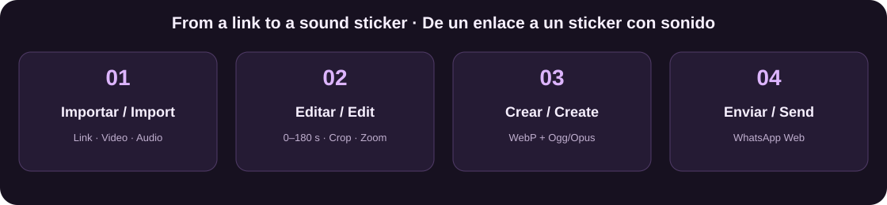

# Stickers Sonoros


**Crea y envía stickers con sonido desde tu celular o computadora.**

[**Abrir la web oficial**](https://poldkent.github.io/stickers-sonoros/) · [English](README.en.md) · [Guía móvil](docs/MOBILE.md#español) · [Apoyar](SUPPORT.md)

[](https://github.com/PoldKent/stickers-sonoros/actions/workflows/smoke.yml) [](https://github.com/PoldKent/stickers-sonoros/actions/workflows/render-diagnostic.yml)

**Versión actual del código: 2026.11.27.54.** El operador confirmó el primer envío a chat propio de .49. Las [pruebas .49](https://github.com/PoldKent/stickers-sonoros/actions/runs/45941677357), [publicación](https://github.com/PoldKent/stickers-sonoros/actions/runs/45941676942) y [diagnóstico del importador](https://github.com/PoldKent/stickers-sonoros/actions/runs/45941827328) finalizaron correctamente. Consulta las ejecuciones actuales para .54. Las cuatro pantallas muestran acciones breves y ayuda desplegable. Las pruebas automatizadas cubren Chromium de escritorio y diseños táctiles de 320–1024 px en español e inglés; los dispositivos físicos iOS/Android requieren validación propia. Se avisa si el navegador carece de codificación nativa Opus o WebP. No equivale a una auditoría externa de seguridad.

## Cuatro pasos



1. **Importar:** selecciona un video, imagen o GIF y audio, o pega un enlace multimedia HTTPS compatible.
2. **Editar:** ajusta recorte, encuadre, zoom, posición y rotación; puedes usar el contenido completo.
3. **Crear:** selecciona calidad (límite automático de 1 MB total), añade una firma opcional y genera el sticker.
4. **Enviar:** conecta tu WhatsApp y confirma el envío a tu propio chat. En computadora, WhatsApp Web está disponible como alternativa dentro de «Otros métodos de envío».

La edición es local; los enlaces públicos usan la API auxiliar. Prueba el ejemplo integrado si no tienes medios. Los botones de navegación conservan el proyecto; cambiar los medios o ajustes invalida el resultado anterior.

## Envío desde el celular

No necesitas computadora, instalar software ni una clave del administrador. En Enviar, pulsa **Comenzar**, introduce tu número internacional propio, acepta la vinculación y completa Turnstile. En WhatsApp abre **Dispositivos vinculados → Vincular dispositivo → Vincular con número de teléfono** e introduce el código de la web. Regresa, pulsa **Enviar a mi propio chat** y confirma. Desconecta y comprueba los dispositivos vinculados al terminar.

Si ya tienes un paquete, abre [Enviar sticker guardado](https://poldkent.github.io/stickers-sonoros/mobile.html). El archivo JSON no es un formato de sticker importable directamente por WhatsApp; no lo adjuntes al chat.

## Envío desde computadora

WhatsApp App es el método predeterminado y utiliza el mismo flujo individual que el celular. Si prefieres WhatsApp Web, abre «Otros métodos de envío» en Enviar, descarga el paquete, instala o actualiza el marcador en los favoritos, abre WhatsApp Web y el chat deseado, ejecuta el marcador, selecciona el JSON y confirma el destinatario. El marcador funciona dentro del navegador y no necesita extensiones. Solo envía si WhatsApp Web tiene habilitado el sonido; no modifica sus funciones internas. Si no está disponible, usa el envío a tu propio WhatsApp. Actualiza los favoritos anteriores.

## Calidad y formatos

| Característica | Límite |
|---|---|
| WebP + Ogg/Opus | 1 MB total (1.000.000 bytes) |
| Resolución máxima | 512 × 512 |
| Animación | ≥9 FPS |
| Duración | Sin límite fijo |

El conversor adapta resolución y compresión al presupuesto sin grabar un video intermedio. El JSON pesa más por Base64. Hay límites de memoria, códecs, entrada (80 MiB) y tiempo de procesamiento. Si no cabe a 9 FPS, acorta el tramo o usa una imagen fija. El modo ampliado se retiró tras fallos reportados por el usuario. Tanto el marcador actualizado como el envío individual rechazan archivos cuya imagen y audio sumen más de 1 MB. Si tienes un paquete antiguo más pesado, vuelve a crearlo desde los medios originales. WhatsApp todavía puede rechazar archivos por otros motivos. La firma opcional (40 caracteres) y la URL oficial se incluyen en EXIF, no sobre la imagen; SHA-256 vincula el audio.

## Privacidad y seguridad

- No pedimos contraseña de WhatsApp, PIN ni códigos SMS. La vinculación se autoriza en WhatsApp.
- Turnstile limita la automatización; cada sesión utiliza una clave aleatoria en memoria del navegador. El servidor comprueba la identidad vinculada y solo permite enviar a su propio número.
- No solicitamos el historial completo ni ofrecemos bandeja de entrada. **Vincular concede a un dispositivo del servidor capacidad potencial de acceder a mensajes.** No es una garantía de confidencialidad absoluta. El transporte no oficial podría provocar restricciones; recomendamos una cuenta secundaria propia.
- Sesiones temporales de hasta 15 minutos y cinco envíos, dos sesiones simultáneas en la beta. Se intenta cerrar el dispositivo y borrar credenciales temporales; comprueba manualmente Dispositivos vinculados. No hay reintentos automáticos tras entregas inciertas.
- Los archivos se editan localmente; solo se transmite el paquete al confirmar el envío. Las importaciones remotas se procesan en una API separada. No se guarda un catálogo de stickers.

Consulta [guía móvil](docs/MOBILE.md), [configuración del puente](experiments/mobile-bridge/README.md) y [auditoría técnica](docs/AUDIT.md). Las pruebas de aislamiento automatizadas no sustituyen pruebas reales simultáneas con cuentas diferentes ni una auditoría independiente.

## Desarrollo y despliegue

| Servicio | Función |
|---|---|
| [GitHub Pages](https://poldkent.github.io/stickers-sonoros/) | Única web oficial |
| [Render importador](https://stickers-sonoros.onrender.com/health) | API `/api/media`, `/api/import`, `/health` |
| [Render Bridge](https://stickers-sonoros-bridge.onrender.com/health) | API individual `/v2` y `/health` |

Las raíces de Render redirigen a la web oficial. El importador usa el Dockerfile raíz; el puente utiliza `experiments/mobile-bridge/Dockerfile.web`. Las claves de Turnstile se configuran en Render, nunca en GitHub. Los servicios gratuitos pueden entrar en reposo.

```sh
python -m http.server 8000
# En otra terminal con FFmpeg, Playwright y Chromium instalados:
node tests/smoke.mjs
node --test experiments/mobile-bridge/*.test.mjs
python -m unittest discover -s importer -p 'test_*.py'
python tests/test_http.py
python tests/test_format_selection.py
```

Las pruebas de selección requieren yt-dlp. Para desarrollo completo local, `docker build --target local-editor -t stickers-sonoros .` y `docker run --rm -p 8080:8080 stickers-sonoros`. El puente real restringe el origen a la web oficial. Los diagnósticos verifican versiones, redirecciones, CORS y acceso sin sesión; no vinculan cuentas. Una importación social real requiere una URL pública autorizada para la prueba opcional. [Historial de CI](https://github.com/PoldKent/stickers-sonoros/actions).

## Créditos y licencia

Importa únicamente contenido autorizado. Conversor y marcador adaptados de [Shirtep/WA-audio-stickers (25f7909)](https://github.com/Shirtep/WA-audio-stickers/tree/25f790945134f395c4bed4f0deea380ac3a2b778), bajo [PolyForm Noncommercial 1.0.0](vendor/shirtep/LICENSE.md). Puente experimental basado en Baileys y [wa-sound-sticker](https://github.com/alkhrzmy/wa-sound-sticker). No somos un producto oficial de WhatsApp. No se otorgan derechos comerciales adicionales; consulta al titular de los derechos para usos comerciales. El apoyo al mantenimiento no comercial es voluntario: [SUPPORT.md](SUPPORT.md).
