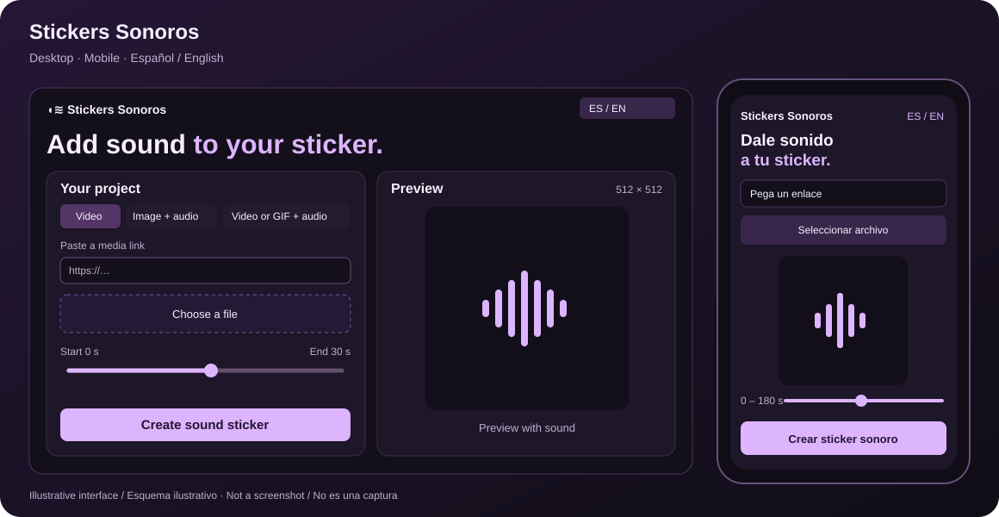

# Stickers Sonoros


**Crea stickers con sonido para WhatsApp en cuatro pasos sencillos.**  
Video, imagen o GIF + audio · 9+ FPS en animaciones · hasta 2 MB combinados · sin límite fijo de duración.

[**Abrir la app oficial**](https://poldkent.github.io/stickers-sonoros/) · [English](README.en.md) · [Guía móvil](docs/MOBILE.md#español) · [Apoyar](SUPPORT.md)

[](https://github.com/PoldKent/stickers-sonoros/actions/workflows/smoke.yml) [](https://github.com/PoldKent/stickers-sonoros/actions/workflows/render-diagnostic.yml)

**Versión validada en producción: 2026.11.26.38 (26/11/2026).** GitHub Pages y Render están sincronizados. [Pruebas del editor y conversor](https://github.com/PoldKent/stickers-sonoros/actions/runs/45870345346), [despliegue web](https://github.com/PoldKent/stickers-sonoros/actions/runs/45870344295) y [diagnóstico de producción, segundo intento](https://github.com/PoldKent/stickers-sonoros/actions/runs/45870691352) aprobados sobre el commit [`5c3471a`](https://github.com/PoldKent/stickers-sonoros/commit/5c3471a8b9651537d59debea6fa8dc0aefcd8b2e). Render es exclusivamente la API; su raíz redirige con HTTP 308 a la única web oficial. El envío real de stickers largos/grandes y la importación nativa móvil siguen sujetos a validación en WhatsApp.

## Guía rápida



| Pantalla | Qué hacer |
|---|---|
| **1. Importar** | Elige Video, Imagen + audio o Video/GIF + audio. Pega un enlace HTTPS público o selecciona un archivo local; añade una pista de audio si corresponde. Pulsa **Siguiente** cuando estén listos el contenido y el sonido. |
| **2. Editar** | Reproduce la vista previa, recorta inicio y final, explora la línea temporal y ajusta encuadre, zoom, posición y rotación. Usa **Usar completo** para restablecer el recorte. Pulsa **Siguiente**. |
| **3. Crear** | Elige calidad y presupuesto de tamaño, añade opcionalmente una firma y pulsa **Crear sticker sonoro**. Revisa el WebP y audio generados, resolución, FPS y peso total. Pulsa **Siguiente** cuando termine la conversión. |
| **4. Enviar** | Guarda el paquete `nombre-original.sonoro.json` y sigue las instrucciones de WhatsApp Web descritas abajo. |

**Anterior** y **Siguiente** conservan el proyecto y sus ajustes. Los botones numerados también permiten navegar a las etapas accesibles. El envío se desbloquea cuando existe un paquete válido. Cambiar el origen, edición, firma o calidad invalida el resultado anterior; vuelve a generarlo. Usa **Probar un ejemplo** en Importar si no tienes un archivo.


## Edición y calidad

- Se selecciona el archivo completo inicialmente, sin límite temporal fijo. La línea bajo la vista previa muestra posición y duración total, con marcadores de inicio/final y reproducción desde el cursor dentro del tramo.
- El lienzo de 512 × 512 permite posición exacta (0,1 px), zoom (0,01 %), rotación en pasos de 90°, ajustar/rellenar y alineación magnética. **Centrar** restablece solo la posición; las guías no se exportan. **Usar fotograma + audio** crea un sticker fijo.
- Todos los modos convierten directamente el archivo original y la pista de audio seleccionada con el encuadre, zoom y rotación elegidos, sin grabar un video intermedio. Los intervalos del WebP animado no se fusionan en pausas largas. Todos los perfiles mantienen al menos 9 FPS codificados; las fuentes estáticas o cuadros repetidos del original no ganan movimiento artificial.
- **Máxima nitidez** prioriza resolución; **Equilibrado** y **Máxima fluidez** ofrecen otras combinaciones. La resolución de salida y compresión se adaptan al presupuesto. Si no cabe con al menos 9 FPS, reduce el tramo o usa un fotograma fijo.

| Límite | Predeterminado: Calidad ampliada | Opcional: Compatible |
|---|---|---|
| WebP + Ogg combinados | 2.000.000 bytes | Hasta 1 MB por componente |
| Animación | ≥9 FPS | ≥9 FPS |
| Duración | Sin límite fijo | Sin límite fijo |

La envoltura JSON pesa más por Base64. Se mantienen las protecciones de entrada local (80 MiB), memoria, códecs y tiempo/peso de las solicitudes del servidor. WhatsApp puede rechazar stickers largos o grandes; 2 MB es el presupuesto experimental del editor, no un límite garantizado por WhatsApp. Los archivos nuevos se limitan a 2.000.000 bytes combinados; el marcador y el puente móvil conservan la lectura de paquetes anteriores de hasta 4 MB. Si falla el envío, usa Compatible (1 MB máximo por componente).

### Firma del creador

Añade opcionalmente un nombre o alias (40 caracteres). El EXIF conserva el paquete **Creado en Stickers Sonoros**, la URL oficial y la firma opcional. La firma es pública para los destinatarios, no se dibuja sobre la imagen. El audio se vincula con SHA-256; WhatsApp decide cómo mostrar la atribución.

### Fuentes de importación

Se admiten video, imagen, GIF y audio locales, medios HTTPS públicos y páginas/enlaces sociales compatibles. La API de Render gestiona importaciones remotas compatibles; la edición es local. Si falla TikTok, la alternativa externa [SnapTik](https://snaptik.fi/) es manual y solo para contenido autorizado; la app no envía automáticamente tu enlace.

## Enviar a WhatsApp

En la pantalla 4, **Enviar**:

1. Pulsa **Guardar sticker sonoro** para descargar `nombre-original.sonoro.json`. No adjuntes directamente el JSON al chat.
2. Muestra la barra de favoritos (Ctrl + Shift + B; Mac: ⌘ + Shift + B). Arrastra **Enviar sticker sonoro** a ella o pulsa **Copiar dirección del marcador** y pégala en la URL de un favorito nuevo. Sustituye los favoritos antiguos.
3. Pulsa **Abrir WhatsApp Web**, inicia sesión y abre tu propio chat para la primera prueba.
4. Pulsa el favorito dentro de WhatsApp Web, selecciona el paquete, pulsa **Enviar sticker con sonido**, confirma el destinatario y comprueba la reproducción. Si se ofrece compatibilidad temporal con sonido, puede ser necesario activarla.

Es una integración no oficial adaptada de Shirtep; la sesión permanece en el navegador. La aceptación depende de WhatsApp y de la cuenta. Si falla, prueba Compatible o un tramo más corto. No requiere extensiones.

### Android y iPhone

El editor funciona en navegadores móviles compatibles. Guarda el paquete en la pantalla 4 y abre [Preparar paquete para WhatsApp móvil](https://poldkent.github.io/stickers-sonoros/mobile.html). La herramienta valida el JSON localmente y permite guardar WebP, Ogg, PNG, WAV o preparar un video compatible con el editor oficial de WhatsApp, si el navegador lo admite. Tras guardar los medios, el botón Abrir WhatsApp intenta abrir la app; selecciona el archivo en Stickers → Crear, no como documento del chat. No envía directamente el JSON ni garantiza duración, atribución o aceptación por WhatsApp. Para conservar el formato original, sigue disponible el envío por WhatsApp Web. Consulta la [guía móvil](docs/MOBILE.md#español).

## Verificación y compatibilidad

| Área | Evidencia |
|---|---|
| Asistente de cuatro pantallas y traducciones | CI de navegador aprobada en .38 |
| Web oficial única y API sincronizada | Diagnóstico .38 aprobado: HTTP 308 en raíz de Render, 404 en app.js, canonical y noindex correctos |
| Importador público en producción | HTTP 200, MP4 de 788.493 bytes; CORS de ambas rutas aprobado (OPTIONS 204) |
| Cadencia de animación de 38 s | CI .36 comprueba 342 cuadros ANMF, tiempos y movimiento a lo largo del clip |
| Imagen + audio de 240 s | CI .35: generación, audio decodificado y envío simulado |
| Envío real a WhatsApp | Confirmado por el usuario en .12; faltan pruebas reales de archivos largos/grandes |
| TikTok | Clip de 27,14 s confirmado por el usuario en .18; no universal |
| Diseño adaptable español/inglés | Chromium a 320, 390, 740 y 1024 px; no certifica dispositivos físicos |

Usa Chrome o Edge actualizados para WebCodecs, WebP y Opus. Los GIF animados requieren ImageDecoder. Importa solo contenido que tengas permiso de utilizar. Las [capturas reales de CI](https://github.com/PoldKent/stickers-sonoros/actions/workflows/smoke.yml) son artefactos temporales; los gráficos del README son esquemas, no capturas.

## Desarrollo y despliegue

**Editor estático:** desde la raíz, ejecuta `python -m http.server 8000` y abre `http://localhost:8000`. Para importar redes sociales, usa el servicio completo.

```sh
docker build --target local-editor -t stickers-sonoros .
docker run --rm -p 8080:8080 stickers-sonoros
```

Abre `http://localhost:8080`. El Dockerfile de la raíz es el único archivo de construcción.

- GitHub Pages es la única web oficial y sirve el frontend desde `main`. Su URL canónica también se incluye en la firma EXIF de los stickers.
- Render aloja exclusivamente la API auxiliar, configurada en `index.html`; su raíz redirige permanentemente a la web oficial (HTTP 308). No sirve el editor ni sus archivos estáticos. Las respuestas llevan `X-Robots-Tag: noindex, nofollow`.
- Render utiliza `render.yaml`, la imagen Docker de producción (sin frontend) y el plan gratuito con despliegue tras superar las comprobaciones. Si no se actualiza automáticamente, usa **Manual sync** en el Blueprint y **Manual Deploy** en el servicio.
- `/health` informa de versión, capacidades y versión de yt-dlp. El plan gratuito puede entrar en reposo.

| Ruta | Propósito |
|---|---|
| GET/HEAD `/` | Redirección permanente a la web oficial |
| GET `/health` | Estado y capacidades |
| POST `/api/import` | Video social público compatible |
| POST `/api/media` | Recurso HTTPS público o HTML inerte |

## Pruebas

```sh
node --check app.js
node --check i18n.js
python -m unittest discover -s importer -p 'test_*.py'
python tests/test_http.py
python tests/test_format_selection.py
```

Para las pruebas de navegador instala Playwright y Chromium en el entorno de desarrollo, inicia el servidor estático en el puerto 8000 y ejecuta `node tests/smoke.mjs`. Las pruebas de navegador utilizan FFmpeg para crear medios de prueba; las de selección necesitan yt-dlp. [Consulta las ejecuciones de CI](https://github.com/PoldKent/stickers-sonoros/actions/workflows/smoke.yml) y [el diagnóstico del servicio real](https://github.com/PoldKent/stickers-sonoros/actions/workflows/render-diagnostic.yml). Las imágenes del README son esquemas ilustrativos; las capturas reales de Chromium se adjuntan a las ejecuciones de CI como artefactos cuando se generan.

## Privacidad y límites

El procesamiento de archivos ocurre localmente por defecto. La importación mediante servidor consulta la URL pública y elimina los archivos temporales después de responder. Los clips editados no se suben al servidor. El importador limita tamaño, tiempo y concurrencia, y el lector HTTPS comprueba dominios, DNS público y TLS. CORS no es autenticación ni sustituye controles de salida de red y aislamiento de infraestructura. No se deben configurar secretos en la instancia pública de importación. Véase [auditoría y seguridad](docs/AUDIT.md).

## ❤️ Apoya el proyecto

Si deseas apoyar voluntariamente el mantenimiento no comercial, consulta [las instrucciones de donación USDC o BBTC por Ethereum (ERC-20)](SUPPORT.md). No uses BTC nativo, otros tokens ni otras redes. La aplicación no vende funciones, no requiere pagos y no automatiza transferencias.

## Créditos y licencia

El conversor y el mecanismo de publicación adaptado proceden de [Shirtep/WA-audio-stickers, commit 25f7909](https://github.com/Shirtep/WA-audio-stickers/tree/25f790945134f395c4bed4f0deea380ac3a2b778). Se conserva el [aviso de autoría y licencia PolyForm Noncommercial 1.0.0](vendor/shirtep/LICENSE.md); no se otorgan derechos de uso comercial ni se implica asociación oficial con WhatsApp, TikTok o Binance. Confirma con el titular de los derechos cualquier uso o financiación que pueda constituir explotación comercial.

### Envío móvil privado (.45)

El primer envío de sticker auténtico, audio, favoritos y reenvío fue confirmado por el operador con .44. La versión .45 incorpora URL fija, sesiones temporales reutilizables y niveles experimentales hasta 2 MB; su aceptación real está pendiente. Consulta [la guía móvil](docs/MOBILE.md). El puente usa un cliente no oficial con riesgo de restricciones; no es una API oficial.
